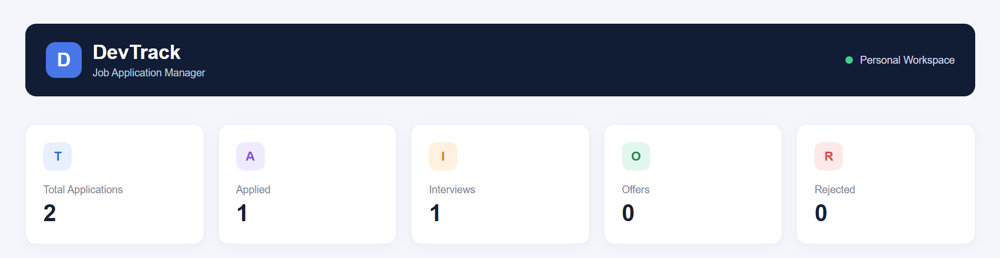
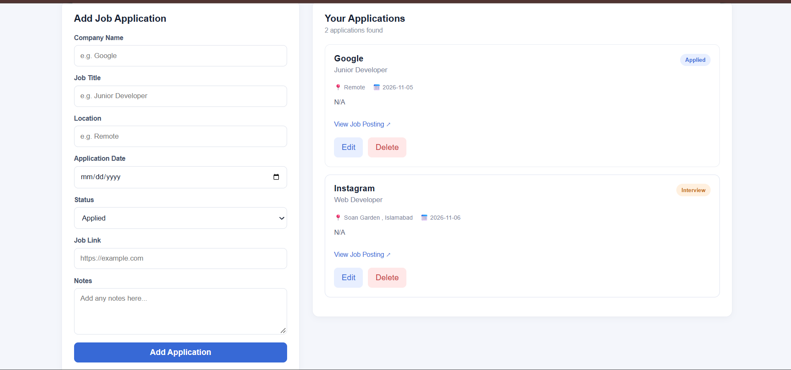
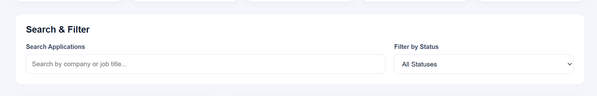

# DevTrack — Job Application Tracker

DevTrack is a responsive job application tracking web application built with React and JavaScript.

It helps users organize their job search by keeping track of companies, job positions, application dates and application statuses.

## Features

- Add new job applications
- Edit existing applications
- Delete applications
- Dashboard with application statistics
- Search by company name and job title
- Filter applications by status
- Persistent data using browser Local Storage
- Responsive design for desktop and mobile
- Direct links to job postings

## Technologies Used

- React
- JavaScript
- Vite
- CSS3
- Browser Local Storage
- Git and GitHub

## Installation

Clone the repository:

```bash
git clone https://github.com/Muhammad-Noor-Dev/devtrack.git
```

Navigate to the project:

```bash
cd devtrack
```

Install dependencies:

```bash
npm install
```

Start the development server:

```bash
npm run dev
```

## Production Build

```bash
npm run build
```

## Data Storage

DevTrack uses browser Local Storage to save application information.

No external database or backend is required.

Data is stored locally in the user's browser and is not synchronized between devices.

## Live Demo

Add your deployed website link here.

## Screenshots

### Dashboard


### Applications


### Search and Filter


## Future Improvements

- User authentication
- Backend integration
- PostgreSQL database
- Application reminders
- Data export
- Application analytics

## Author

Muhammad Noor

GitHub: https://github.com/Muhammad-Noor-Dev
